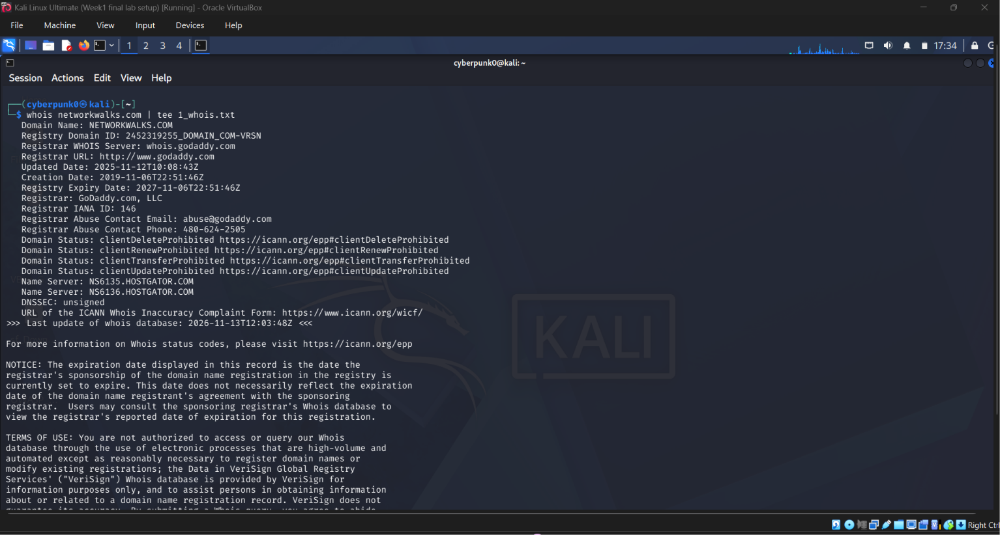
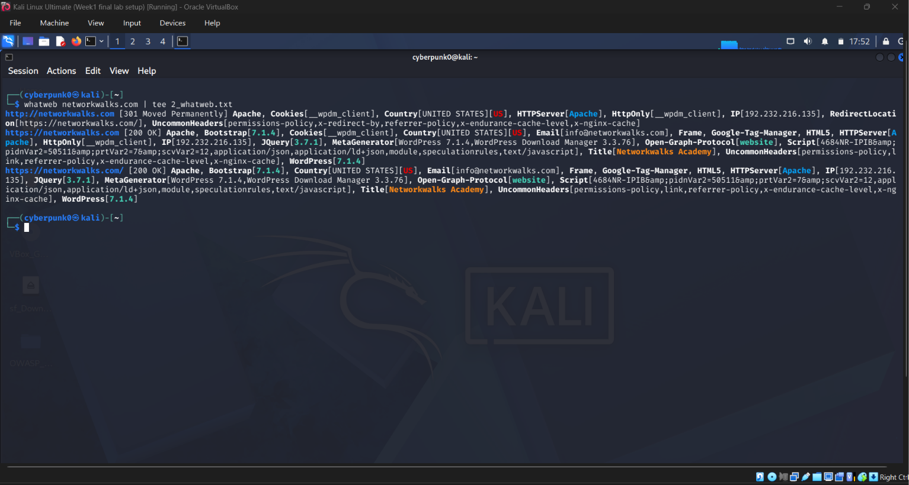
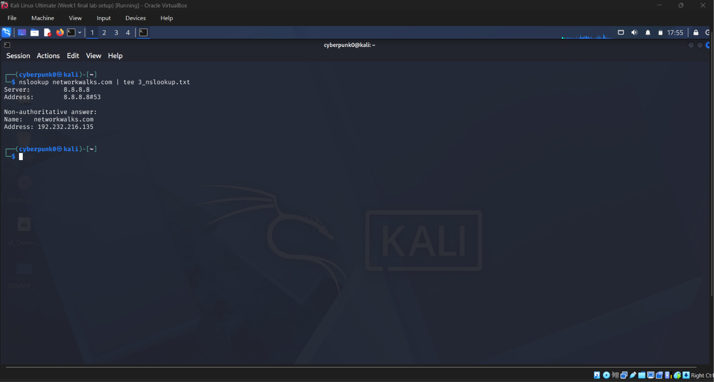
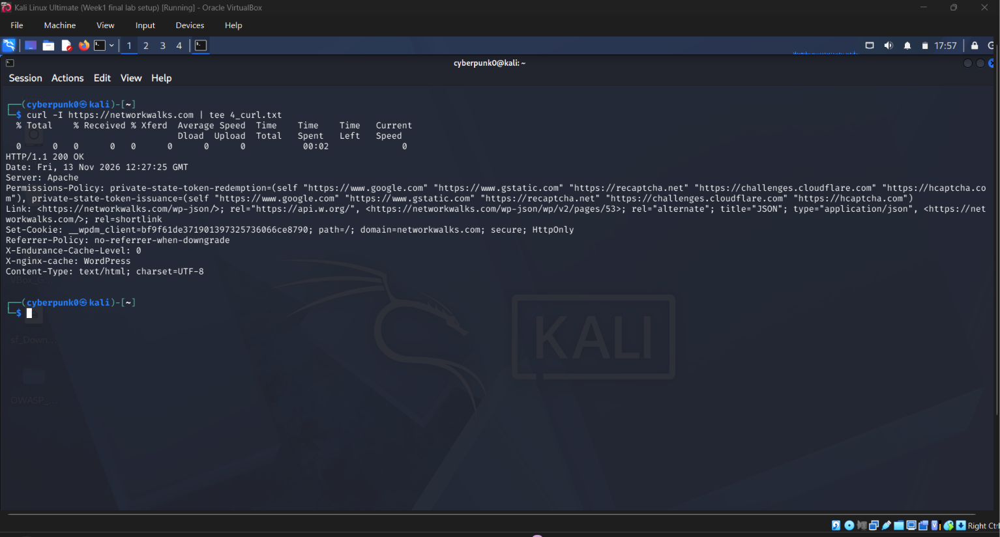
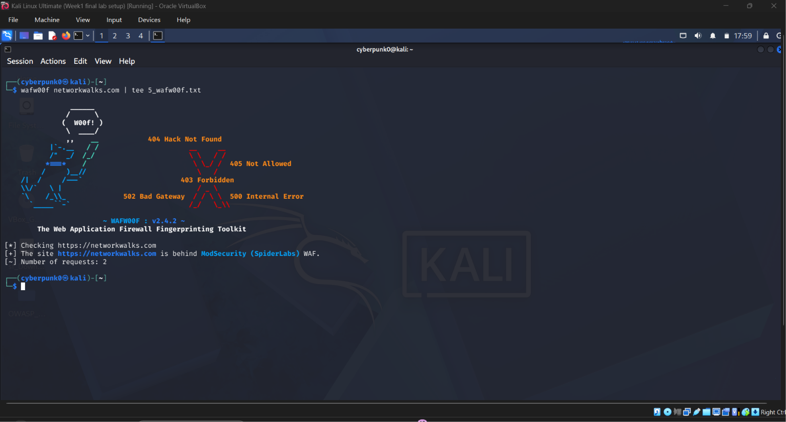
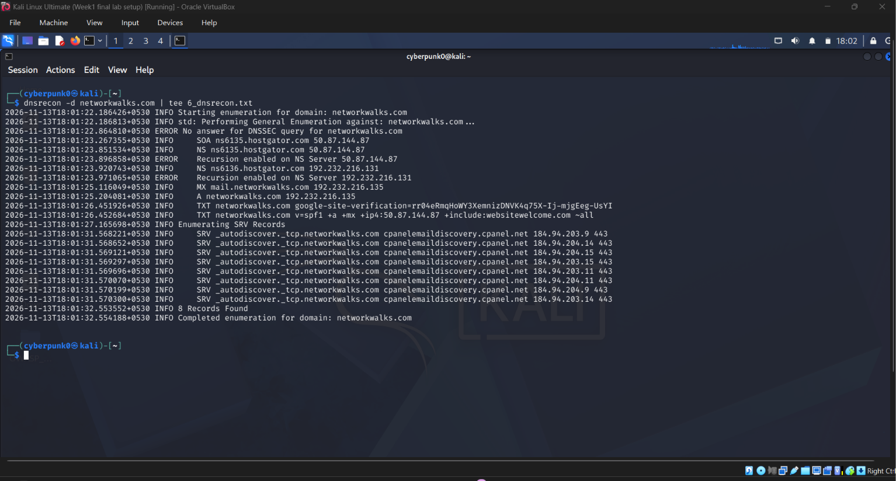
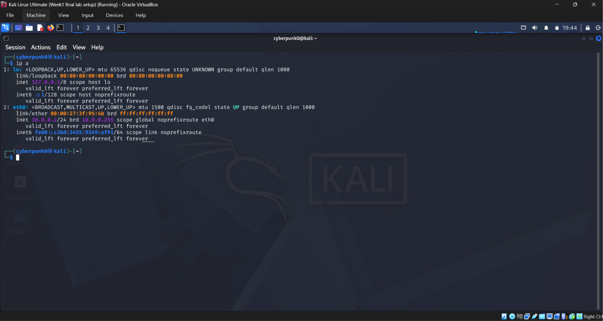
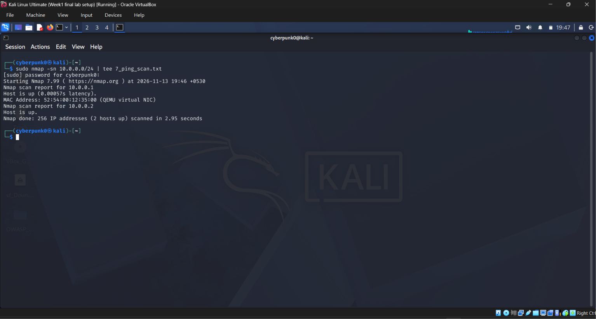
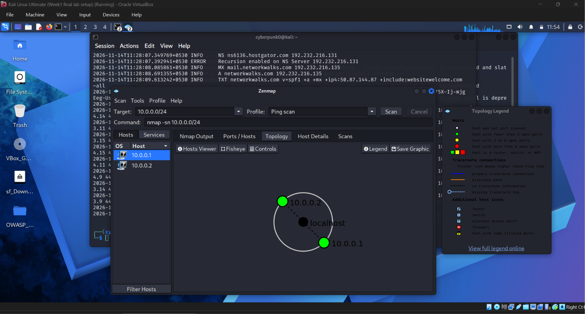

# Week 2: Footprinting and Network Scanning (W2-PM1, W2-PM5, W2-PM-FINAL)

**Name:** Durgaprasad Veesam | **Batch:** B084 | **Intern ID:** NW-084-000
**Date:** 14 November 2026
**Modules completed:** W2-PM1 (Footprinting with multiple Kali tools), W2-PM5 (Network scanning with Zenmap), W2-PM-FINAL (report)

**Full report:** [Durgaprasad_Veesam_Week2_Report.docx](Durgaprasad_Veesam_Week2_Report.docx)

## Liability Disclaimer
I performed these activities only on networkwalks.com (the internship's training target) and on my own lab network. This is for education only. Unauthorised access is a crime.

## Phase 1: Footprinting (W2-PM1)
Target: networkwalks.com. Commands were run in Kali Linux.

| Tool | Command | What I found | Evidence |
|------|---------|--------------|----------|
| whois | `whois networkwalks.com` | Registrar GoDaddy, name servers at HostGator, owner hidden by privacy service | [text](1_whois.txt) |
| whatweb | `whatweb networkwalks.com` | Apache, WordPress 7.1.4, WordPress Download Manager 3.3.76, IP 192.232.216.135 | [text](2_whatweb.txt) |
| nslookup | `nslookup networkwalks.com` | IP address 192.232.216.135 | [text](3_nslookup.txt) |
| curl | `curl -I https://networkwalks.com` | 200 OK, Apache, /wp-json/ and cache headers exposed | [text](4_curl.txt) |
| wafw00f | `wafw00f networkwalks.com` | Behind ModSecurity (SpiderLabs) WAF | [text](5_wafw00f.txt) |
| dnsrecon | `dnsrecon -d networkwalks.com` | 8 records, SPF soft fail, recursion enabled on name servers | [text](6_dnsrecon.txt) |

## Phase 2: Network Scanning (W2-PM5)
- My Kali IP and subnet: **10.0.0.2/24**, MAC 08:00:27:3f:95:4b (`ip a`).
- Command: `sudo nmap -sn 10.0.0.0/24` (same as the Zenmap Ping scan).
- Result: **2 hosts up**.

| Live host | MAC address | Note |
|-----------|-------------|------|
| 10.0.0.1 | 52:54:00:12:35:00 | VirtualBox NAT gateway |
| 10.0.0.2 | 08:00:27:3f:95:4b | My Kali VM |

Topology PDF: [topology.pdf](topology.pdf) | Scan output: [7_ping_scan.txt](7_ping_scan.txt)

## Troubleshooting
**Problem:** Zenmap would not install on my Windows PC. The Npcap service failed with error 0x8007007e, even with the official installer.
**Solution:** I used Zenmap and Nmap in my Kali Linux VM and scanned my own lab network instead.

**Problem:** `6_dnsrecon.txt` was empty after `dnsrecon -d networkwalks.com | tee 6_dnsrecon.txt`.
**Solution:** dnsrecon writes to the error stream. I used `2>&1 | tee` to save the output.

## What I Learned
- Footprinting uses only public information, so the target does not know.
- Ping scans find live hosts and their MAC addresses.
- A good report shows the command, the result, evidence and a recommendation.

*All activities were done only on authorised or own systems, for learning.*
